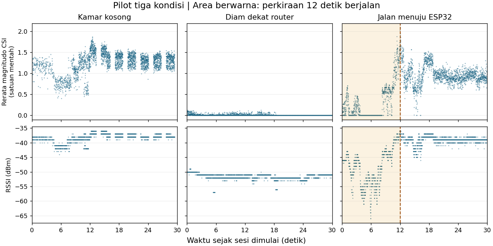

# Uji awal rekaman CSI di kamar

Pada 17 November 2026, ESP32-S3 N16R8 dipakai untuk merekam CSI dari router pada kanal 5 di pita 2,4 GHz. Router diletakkan di meja besar, sedangkan ESP32 dihubungkan ke laptop di meja lain. Ada tiga sesi, masing-masing 30 detik. Tujuannya untuk mengecek apa yang benar-benar tersimpan di laptop sebelum menyiapkan pengambilan data aktivitas.

## Hasil tiga sesi

| Kondisi | Sampel tersimpan | Sampel dengan seluruh nilai CSI nol | Median RSSI |
| --- | ---: | ---: | ---: |
| Kamar kosong | 2.991 | 0 (0%) | -38 dBm |
| Diam dekat meja router | 3.042 | 2.385 (78,4%) | -52 dBm |
| Jalan dari meja router ke meja ESP32, lalu berhenti | 3.034 | 582 (19,2%) | -40 dBm |

Seluruh 9.067 baris CSI lengkap berhasil dibaca. Setiap baris memuat 128 komponen. Nomor urut, RSSI, dan seluruh nilai CSI pada setiap baris dicocokkan kembali dengan keluaran serial asli. Nomor urut berurutan di dalam tiap sesi. Meski begitu, pada sesi kamar kosong terdapat jeda 1,008 detik antara dua sampel menurut waktu perangkat. Jeda terpanjang pada sesi diam dan jalan masing-masing sekitar 36 dan 29 milidetik.

Grafik atas menunjukkan rata-rata magnitudo pasangan komponen CSI yang dikirim firmware per paket. Grafik bawah menunjukkan kekuatan sinyal yang diterima (RSSI). Sumbu waktu mengikuti waktu baca di laptop. Berdasarkan catatan setelah pengujian, perjalanan antarmeja memerlukan sekitar 12 detik. Garis putus-putus menunjukkan perkiraan waktu tiba jika langkah pertama dimulai saat tanda mulai.

Pada 12 detik pertama sesi jalan, rentang persentil ke-10 hingga ke-90 RSSI adalah -57 hingga -39 dBm. Setelah perkiraan waktu tiba, rentangnya menyempit menjadi -40 hingga -38 dBm. Data CSI juga berbeda. Pada bagian awal, 578 dari 1.214 sampel berisi nol di semua komponen. Pada bagian berikutnya, hanya 4 dari 1.820 sampel yang demikian. Baru satu lintasan yang direkam, dan posisi tubuh terhadap router serta ESP32 ikut berubah sepanjang lintasan. Pengaruh gerakan dan posisi belum bisa dipisahkan.

## Mengapa banyak nilai nol?

Pada sesi diam, nilai nol sudah muncul pada keluaran serial ESP32 ketika RSSI masih terbaca. Pada sumber firmware yang digunakan (contoh `csi_recv_router`, ESP-IDF 5.4.2), komponen CSI dikalikan dengan faktor kompensasi penguatan sinyal, lalu dikonversi ke bilangan bulat sebelum dikirim. Nilai hasil perkalian dengan magnitudo kurang dari satu akan menjadi nol. Rekaman ini hanya memuat nilai sesudah konversi, sehingga penyebab nol pada tiap paket belum dapat dipastikan. [Kode firmware Espressif](https://github.com/espressif/esp-csi/blob/8633d67152db2808f141cc1595970aa9cf406045/examples/get-started/csi_recv_router/main/app_main.c)

Pada uji berikutnya, nilai CSI sebelum kompensasi, faktor pengali, dan hasil konversi perlu dibandingkan untuk paket yang sama, terutama pada posisi diam dekat router. Pemeriksaan ini membantu menentukan di tahap mana nilai nol mulai muncul sebelum rekaman dipakai untuk melatih model. Deteksi jatuh dan adaptasi model belum diuji pada sesi ini.

[Cara menjalankan perekam dan membuka data mentah di laptop](../akuisisi.md)
