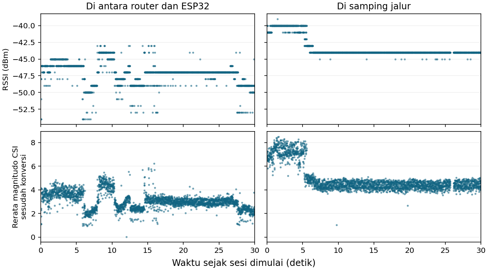

# Log 6. Uji rekaman CSI di kamar

Perekaman CSI dari router ke ESP32-S3 sudah dicoba pada tiga kondisi, yaitu kamar kosong, diam dekat router, dan berjalan dari meja router ke meja ESP32. Tiap kondisi direkam selama 30 detik. Perjalanan antarmeja memakan waktu sekitar 12 detik. Di grafik RSSI, kekuatan sinyal terlihat lebih banyak berubah selama berjalan, lalu lebih stabil setelah sampai di meja ESP32.

Sesi diam juga dicoba di dua posisi, masing-masing selama 30 detik. Posisi pertama berada di antara router dan ESP32. Posisi kedua berada di samping jalur tersebut.

| Posisi berdiri | Paket CSI yang terbaca | Median kekuatan sinyal (RSSI) |
| --- | ---: | ---: |
| Di antara router dan ESP32 | 2.843 | -47 dBm |
| Di samping jalur | 2.753 | -44 dBm |

Pada uji ini, median kekuatan sinyal di posisi pertama 3 dB lebih rendah. Posisi berdiri dan arah hadap akan ikut dicatat saat membandingkan rekaman dari beberapa tata letak ruangan.

Firmware diagnostik juga sudah bisa menyimpan CSI sebelum dan sesudah kompensasi dari paket yang sama. Grafiknya bisa dilihat dari [uji ulang sesi diam](perbandingan_gain.png), [sesi diam di jalur](gain_di_jalur.png), dan [sesi diam di samping jalur](gain_di_samping.png).

[Panduan perekaman](../akuisisi.md) · [Kode perekam di laptop](../../scripts/uji_diam_gain.py)
