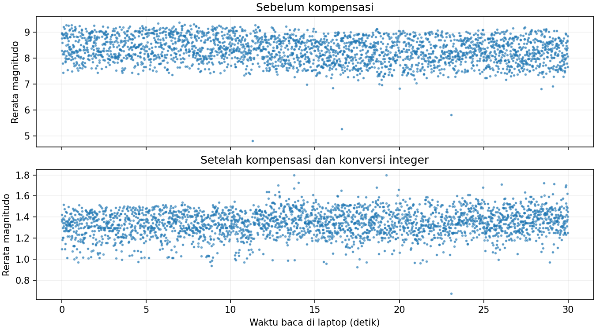

# Log 6. Uji ulang CSI saat diam dekat router

Pada uji pertama, 2.385 dari 3.042 paket saat diam memiliki nilai nol di seluruh 128 komponen CSI. Pada 18 November 2026 sekitar pukul 00.07 WIB, sesi diam diulang selama 30 detik. Firmware diagnostik ESP32-S3 mengirim dua versi data untuk paket yang sama. Versi pertama diambil dari buffer CSI perangkat. Versi kedua diambil setelah setiap komponen dikalikan dengan faktor kompensasi lalu dikonversi ke bilangan bulat. [Hasil pilot pertama](../pilot-2026-11-17/README.md)

| Pengukuran sesi diam | Pilot pertama | Uji ulang |
| --- | ---: | ---: |
| Paket lengkap yang tersimpan | 3.042 | 2.660 |
| Paket dengan seluruh komponen nol sebelum kompensasi | Tidak direkam | 0 |
| Paket dengan seluruh komponen nol sesudah konversi | 2.385 (78,4%) | 0 |
| Median kekuatan sinyal (RSSI) | -52 dBm | -41 dBm |

Kedua panel memakai waktu yang sama. Skala vertikal masing-masing panel berbeda. Untuk menghitung paket nol, seluruh komponen diperiksa langsung dari data per paket.

**Apa yang terjadi pada komponen CSI?** Pada uji ulang, ada 266.950 komponen bernilai bukan nol sebelum kompensasi. Setelah konversi, 85.196 di antaranya (31,9%) berubah menjadi nol. Faktor kompensasi berkisar antara 0,188 dan 0,345. Dengan pengali di bawah satu, nilai kecil bisa turun ke rentang antara -1 dan 1, lalu menjadi nol saat dikonversi ke bilangan bulat. Pada setiap paket masih ada komponen yang memiliki nilai. Saat perkalian dan konversi dihitung kembali di laptop, hasilnya cocok untuk seluruh 340.480 komponen yang direkam.

**Apa yang bisa dibandingkan?** Baris diagnostik lengkap pada rekaman serial dicocokkan dengan hasil pembacaan di laptop. Semua 2.660 paket dapat dipakai dan nomor urutnya berurutan. Laju pencatatan sekitar 89 paket per detik selama 30 detik. Format diagnostik membawa dua larik CSI sehingga panjang baris serial berbeda dari pilot pertama.

Median RSSI pada uji ulang lebih kuat 11 dB. Sesi pertama hanya menyimpan CSI sesudah konversi. Karena itu, penyebab paket yang seluruh komponennya nol pada sesi pertama belum bisa dipastikan dari uji ulang ini. Langkah berikutnya adalah mengulang posisi diam dengan titik, arah tubuh, serta posisi perangkat yang ditandai, lalu membandingkan RSSI, faktor pengali, dan jumlah paket nol antarulangan. Hasil ini dipakai untuk menilai kualitas akuisisi sebelum pengambilan data aktivitas.

[Kode firmware diagnostik](../../firmware/diagnostik-s3/app_main.c) · [Perekam di laptop](../../scripts/uji_diam_gain.py) · [Panduan uji diam](../akuisisi.md)
